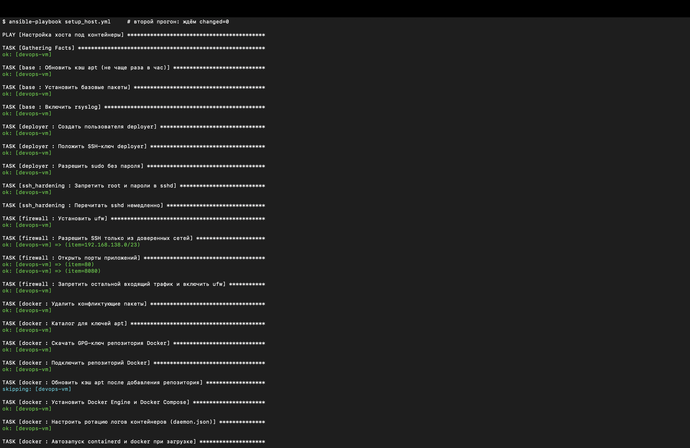
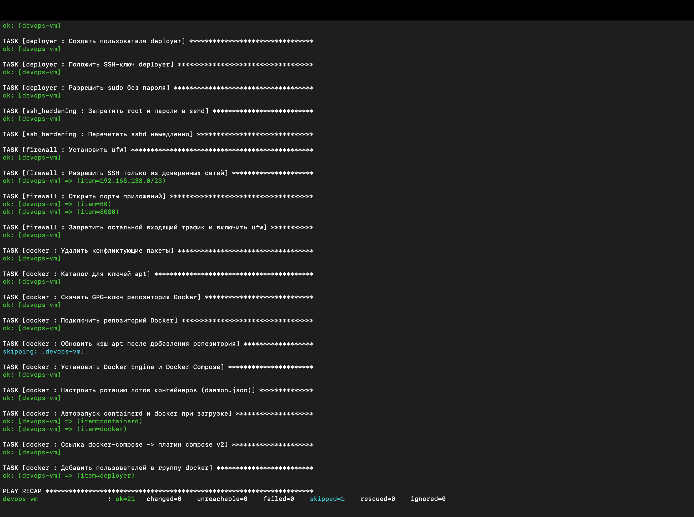
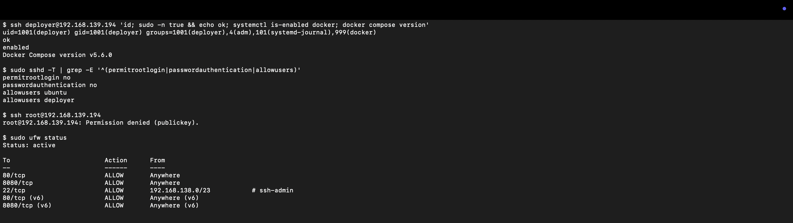
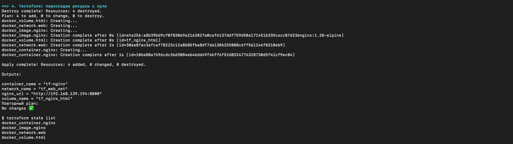
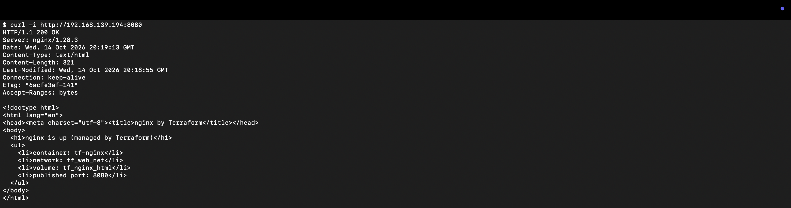
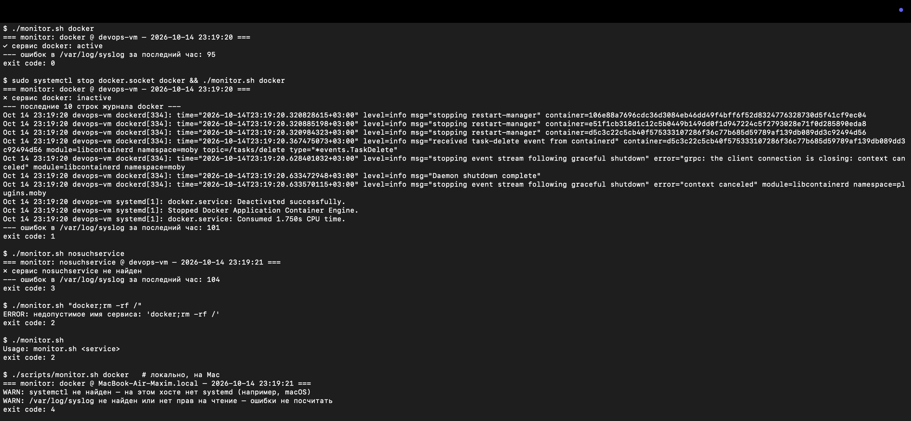
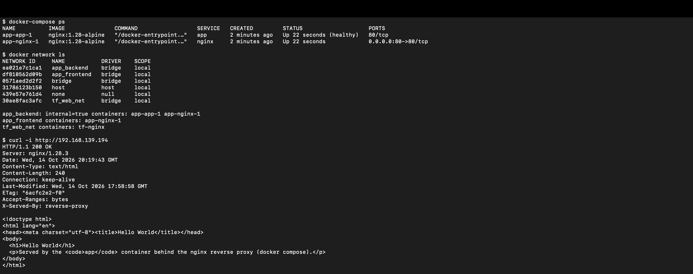
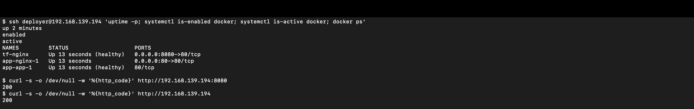

# ДЗ #1 — Фундамент DevOps-инфраструктуры

Воспроизводимая базовая инфраструктура: **Ansible** готовит хост (пользователь `deployer`, Docker Engine + Compose, hardening),
**Terraform** (провайдер [`kreuzwerker/docker`](https://github.com/kreuzwerker/terraform-provider-docker)) поднимает nginx в
отдельной docker-сети с томом, **Docker Compose** разворачивает reverse proxy + app в своей сети, **Bash** (`monitor.sh`) следит за сервисами.

> **Поправка преподавателя к ДЗ** (учтена):
> 1. сначала выполняется п.3 (Ansible), потом п.2 (Terraform);
> 2. в Terraform используется docker-провайдер: `main.tf` создаёт **новую сеть**, **том** и контейнер **nginx**, который на
>    **нестандартном порту** (8080) по `curl -i` отдаёт `200 OK`;
> 3. остальные контейнеры ДЗ (compose) работают в своей сети.

## Архитектура

```
 macOS (control node)                                    VM "devops-vm" — Ubuntu 22.04 (OrbStack)
 ┌──────────────────────┐   SSH, 192.168.139.194      ┌───────────────────────────────────────────────────────┐
 │ scripts/bootstrap_vm │ ──────────────────────────▶ │ sshd: только ключи, root запрещён, AllowUsers         │
 │ ansible-playbook     │ ── ubuntu@ (become) ──────▶ │ ufw: 22 только из сети хоста, открыты 80 и 8080        │
 │ terraform            │ ── ssh://deployer@ ───────▶ │ dockerd (systemd, enabled)                             │
 │ curl                 │                             │                                                       │
 └──────────┬───────────┘                             │  network tf_web_net 10.20.0.0/24      (Terraform)     │
            │ :8080                                   │   └─ tf-nginx ── volume tf_nginx_html                 │
            ├───────────────────────────────────────▶ │        :8080 → :80                                    │
            │ :80                                     │                                                       │
            └───────────────────────────────────────▶ │  network app_frontend                 (Compose)      │
                                                      │   └─ nginx (reverse proxy) :80 → :80                  │
                                                      │  network app_backend (internal)                       │
                                                      │   └─ nginx ──proxy_pass──▶ app (Hello World)          │
                                                      └───────────────────────────────────────────────────────┘
```

Порядок: `bootstrap_vm.sh` → `setup_host.yml` (Ansible) → `terraform apply` → `deploy_app.yml` (Compose).
Terraform идёт после Ansible не случайно: docker-провайдер управляет Docker'ом, который ставит Ansible, и ходит туда пользователем `deployer`, которого создаёт Ansible.

## Структура репозитория

```
.
├── ansible/
│   ├── ansible.cfg
│   ├── inventory.ini              # хост VM
│   ├── requirements.yml           # коллекции: ansible.posix, community.general, community.docker
│   ├── group_vars/app_hosts.yml   # переменные (deployer, firewall, docker)
│   ├── setup_host.yml             # этап 3: подготовка хоста
│   ├── deploy_app.yml             # этап 5: выкладка compose в /opt/app
│   └── roles/
│       ├── base/                  # apt-кэш, базовые пакеты, rsyslog
│       ├── deployer/              # пользователь deployer, ключ, sudo NOPASSWD (с visudo-валидацией)
│       ├── ssh_hardening/         # PermitRootLogin no, PasswordAuthentication no, AllowUsers
│       ├── firewall/              # ufw — аналог Security Group
│       ├── docker/                # Docker CE + compose plugin, daemon.json, автозапуск
│       └── app/                   # копирование compose в /opt/app и docker compose up -d
├── terraform/
│   ├── versions.tf                # terraform + провайдер kreuzwerker/docker ~> 4.6, local backend
│   ├── variables.tf               # все параметры вынесены в переменные (с валидацией)
│   ├── main.tf                    # network + volume + image + container nginx
│   ├── outputs.tf
│   ├── files/index.html.tftpl     # страница, которая кладётся в том
│   └── terraform.tfvars.example
├── compose/
│   ├── docker-compose.yml         # nginx (reverse proxy) + app
│   ├── proxy/default.conf
│   └── app/index.html
├── scripts/
│   ├── bootstrap_vm.sh            # создание VM (аналог cloud-init)
│   └── monitor.sh                 # этап 4: мониторинг сервиса и syslog
└── docs/                          # выводы команд для отчёта, screenshots/ — скриншоты
```

## Требования

| Инструмент | Версия (проверено) | Установка |
|---|---|---|
| OrbStack (Linux machines) | 2.0.5 | https://orbstack.dev |
| Terraform | 1.16.6 | бинарь с releases.hashicorp.com (или `brew install hashicorp/tap/terraform`) |
| Ansible (ansible-core) | 2.21.5 | `uv tool install ansible-core` (или `pipx install ansible-core`) |
| Коллекции Ansible | см. `ansible/requirements.yml` | `ansible-galaxy collection install -r ansible/requirements.yml` |

Подойдёт и любая другая Ubuntu 22.04 VM (VirtualBox/Proxmox/облако): достаточно поменять `ansible_host` в `inventory.ini`, `firewall_ssh_allowed_from` в `group_vars/app_hosts.yml`
(иначе ufw закроет SSH) и `vm_host` в `terraform.tfvars`.

## Как развернуть

```bash
# 0. VM: Ubuntu 22.04 + sshd + админ `ubuntu` с SSH-ключом (аналог cloud-init)
./scripts/bootstrap_vm.sh

# 1. Этап 3 — Ansible: deployer, Docker, hardening. Второй прогон должен дать changed=0
cd ansible
ansible-galaxy collection install -r requirements.yml
ansible-playbook setup_host.yml
ansible-playbook setup_host.yml          # проверка идемпотентности

# 2. Этап 2 — Terraform (docker provider): сеть + том + nginx на :8080
cd ../terraform
terraform init
terraform plan -out=tfplan
terraform apply tfplan
curl -i http://192.168.139.194:8080

# 3. Этап 4 — мониторинг
../scripts/monitor.sh docker                                   # локально (macOS: без systemd → код 4)
scp ../scripts/monitor.sh deployer@192.168.139.194:~/
ssh deployer@192.168.139.194 './monitor.sh docker'         # на VM

# 4. Этап 5 — Docker Compose в /opt/app
cd ../ansible
ansible-playbook deploy_app.yml              # копирует compose в /opt/app и делает docker-compose up -d
ssh deployer@192.168.139.194 'cd /opt/app && docker-compose ps'
curl -i http://192.168.139.194
```

Удаление: `terraform destroy` в `terraform/`, `docker compose down` в `/opt/app`, `orb delete devops-vm`.

## Результаты (реальные выводы)

Все команды выполнены по IP VM `192.168.139.194`. Полные текстовые логи — в [`docs/`](docs/), скриншоты — в [`docs/screenshots/`](docs/screenshots/).

### 1. Ansible: идемпотентность `setup_host.yml`

Хост уже был настроен предыдущими прогонами, поэтому и первый (`devops-vm                  : ok=21   changed=0    unreachable=0    failed=0    skipped=1    rescued=0    ignored=0`), и второй прогон дают
`changed=0`. `skipped=1` — обновление кэша apt, оно выполняется только при изменении репозитория Docker.





<details>
<summary>Текстом</summary>

```text
$ ansible-playbook setup_host.yml
PLAY [Настройка хоста под контейнеры] ******************************************
TASK [Gathering Facts] *********************************************************
ok: [devops-vm]
TASK [base : Обновить кэш apt (не чаще раза в час)] ****************************
ok: [devops-vm]
TASK [base : Установить базовые пакеты] ****************************************
ok: [devops-vm]
TASK [base : Включить rsyslog] *************************************************
ok: [devops-vm]
TASK [deployer : Создать пользователя deployer] ********************************
ok: [devops-vm]
TASK [deployer : Положить SSH-ключ deployer] ***********************************
ok: [devops-vm]
TASK [deployer : Разрешить sudo без пароля] ************************************
ok: [devops-vm]
TASK [ssh_hardening : Запретить root и пароли в sshd] **************************
ok: [devops-vm]
TASK [ssh_hardening : Перечитать sshd немедленно] ******************************
TASK [firewall : Установить ufw] ***********************************************
ok: [devops-vm]
TASK [firewall : Разрешить SSH только из доверенных сетей] *********************
ok: [devops-vm] => (item=192.168.138.0/23)
TASK [firewall : Открыть порты приложений] *************************************
ok: [devops-vm] => (item=80)
ok: [devops-vm] => (item=8080)
TASK [firewall : Запретить остальной входящий трафик и включить ufw] ***********
ok: [devops-vm]
TASK [docker : Удалить конфликтующие пакеты] ***********************************
ok: [devops-vm]
TASK [docker : Каталог для ключей apt] *****************************************
ok: [devops-vm]
TASK [docker : Скачать GPG-ключ репозитория Docker] ****************************
ok: [devops-vm]
TASK [docker : Подключить репозиторий Docker] **********************************
ok: [devops-vm]
TASK [docker : Обновить кэш apt после добавления репозитория] ******************
skipping: [devops-vm]
TASK [docker : Установить Docker Engine и Docker Compose] **********************
ok: [devops-vm]
TASK [docker : Настроить ротацию логов контейнеров (daemon.json)] **************
ok: [devops-vm]
TASK [docker : Автозапуск containerd и docker при загрузке] ********************
ok: [devops-vm] => (item=containerd)
ok: [devops-vm] => (item=docker)
TASK [docker : Ссылка docker-compose -> плагин compose v2] *********************
ok: [devops-vm]
TASK [docker : Добавить пользователей в группу docker] *************************
ok: [devops-vm] => (item=deployer)
PLAY RECAP *********************************************************************
devops-vm                  : ok=21   changed=0    unreachable=0    failed=0    skipped=1    rescued=0    ignored=0   
```

</details>

### 2. Проверка хоста: `deployer`, sshd, ufw



```text
$ ssh deployer@192.168.139.194 'id; sudo -n true && echo ok; systemctl is-enabled docker; docker compose version'
uid=1001(deployer) gid=1001(deployer) groups=1001(deployer),4(adm),101(systemd-journal),999(docker)
ok
enabled
Docker Compose version v5.6.0

$ sudo sshd -T | grep -E '^(permitrootlogin|passwordauthentication|allowusers)'
permitrootlogin no
passwordauthentication no
allowusers ubuntu
allowusers deployer

$ ssh root@192.168.139.194
root@192.168.139.194: Permission denied (publickey).

$ sudo ufw status
Status: active

To                         Action      From
--                         ------      ----
80/tcp                     ALLOW       Anywhere                  
8080/tcp                   ALLOW       Anywhere                  
22/tcp                     ALLOW       192.168.138.0/23           # ssh-admin
80/tcp (v6)                ALLOW       Anywhere (v6)             
8080/tcp (v6)              ALLOW       Anywhere (v6)             
```

### 3. Terraform: `apply` и `state list`



```text
$ terraform apply tfplan
docker_volume.html: Creating...
docker_network.web: Creating...
docker_image.nginx: Creating...
docker_image.nginx: Creation complete after 0s [id=sha256:a8b39bd9cf0f83869a2162827a0caf6137ddf759d50a171451b335cecc87d236nginx:1.28-alpine]
docker_volume.html: Creation complete after 0s [id=tf_nginx_html]
docker_network.web: Creation complete after 2s [id=30ae8fac3afcaf78223c12a8b85fbe8df7da1386255088c6ff561246f8310eb9]
docker_container.nginx: Creating...
docker_container.nginx: Creation complete after 1s [id=106e88a7696cdc36d3084eb46dd49f4bff6f52d8324776328730d5f41cf9ec04]
Apply complete! Resources: 4 added, 0 changed, 0 destroyed.
Outputs:
container_name = "tf-nginx"
network_name = "tf_web_net"
nginx_url = "http://192.168.139.194:8080"
volume_name = "tf_nginx_html"
```

```text
$ terraform state list
docker_container.nginx
docker_image.nginx
docker_network.web
docker_volume.html
```

Повторный `terraform plan` → `No changes. Your infrastructure matches the configuration.`

### 4. Terraform: `curl -i` на нестандартный порт 8080



```text
$ curl -i http://192.168.139.194:8080
HTTP/1.1 200 OK
Server: nginx/1.28.3
Date: Wed, 14 Oct 2026 20:19:13 GMT
Content-Type: text/html
Content-Length: 321
Last-Modified: Wed, 14 Oct 2026 20:18:55 GMT
Connection: keep-alive
ETag: "6acfe3af-141"
Accept-Ranges: bytes

<!doctype html>
<html lang="en">
<head><meta charset="utf-8"><title>nginx by Terraform</title></head>
<body>
  <h1>nginx is up (managed by Terraform)</h1>
  <ul>
    <li>container: tf-nginx</li>
    <li>network: tf_web_net</li>
    <li>volume: tf_nginx_html</li>
    <li>published port: 8080</li>
  </ul>
</body>
</html>
```

Контейнер — только в своей сети, с томом:

```text
$ docker ps --filter name=tf-nginx
NAMES      STATUS                    PORTS                  NETWORKS
tf-nginx   Up 25 seconds (healthy)   0.0.0.0:8080->80/tcp   tf_web_net
$ docker inspect tf-nginx
networks: tf_web_net=10.20.0.2 | mounts: volume:tf_nginx_html->/usr/share/nginx/html | restart: unless-stopped
```

### 5. `monitor.sh`

На VM (пользователь `deployer`, без sudo — права на логи дают группы `adm`/`systemd-journal`) и локально на Mac
(нет systemd и `/var/log/syslog` — скрипт сообщает об этом и выходит с кодом 4):



<details>
<summary>Текстом</summary>

```text
$ ./monitor.sh docker
=== monitor: docker @ devops-vm — 2026-10-14 23:19:20 ===
✓ сервис docker: active
--- ошибок в /var/log/syslog за последний час: 95
exit code: 0
$ sudo systemctl stop docker.socket docker && ./monitor.sh docker
=== monitor: docker @ devops-vm — 2026-10-14 23:19:20 ===
✗ сервис docker: inactive
--- последние 10 строк журнала docker ---
Oct 14 23:19:20 devops-vm dockerd[334]: time="2026-10-14T23:19:20.320828615+03:00" level=info msg="stopping restart-manager" container=106e88a7696cdc36d3084eb46dd49f4bff6f52d8324776328730d5f41cf9ec04
Oct 14 23:19:20 devops-vm dockerd[334]: time="2026-10-14T23:19:20.320885198+03:00" level=info msg="stopping restart-manager" container=e51f1cb318d1c12c5b0449b149dd0f1d947224c5f2793028e71f0d285890eda8
Oct 14 23:19:20 devops-vm dockerd[334]: time="2026-10-14T23:19:20.320984323+03:00" level=info msg="stopping restart-manager" container=d5c3c22c5cb40f575333107286f36c77b685d59789af139db089dd3c92494d56
Oct 14 23:19:20 devops-vm dockerd[334]: time="2026-10-14T23:19:20.367475073+03:00" level=info msg="received task-delete event from containerd" container=d5c3c22c5cb40f575333107286f36c77b685d59789af139db089dd3c92494d56 module=libcontainerd namespace=moby topic=/tasks/delete type="*events.TaskDelete"
Oct 14 23:19:20 devops-vm dockerd[334]: time="2026-10-14T23:19:20.628401032+03:00" level=info msg="stopping event stream following graceful shutdown" error="grpc: the client connection is closing: context canceled" module=libcontainerd namespace=moby
Oct 14 23:19:20 devops-vm dockerd[334]: time="2026-10-14T23:19:20.633472948+03:00" level=info msg="Daemon shutdown complete"
Oct 14 23:19:20 devops-vm dockerd[334]: time="2026-10-14T23:19:20.633570115+03:00" level=info msg="stopping event stream following graceful shutdown" error="context canceled" module=libcontainerd namespace=plugins.moby
Oct 14 23:19:20 devops-vm systemd[1]: docker.service: Deactivated successfully.
Oct 14 23:19:20 devops-vm systemd[1]: Stopped Docker Application Container Engine.
Oct 14 23:19:20 devops-vm systemd[1]: docker.service: Consumed 1.750s CPU time.
--- ошибок в /var/log/syslog за последний час: 101
exit code: 1
$ ./monitor.sh nosuchservice
=== monitor: nosuchservice @ devops-vm — 2026-10-14 23:19:21 ===
✗ сервис nosuchservice не найден
--- ошибок в /var/log/syslog за последний час: 104
exit code: 3
$ ./monitor.sh "docker;rm -rf /"
ERROR: недопустимое имя сервиса: 'docker;rm -rf /'
exit code: 2
$ ./monitor.sh
Usage: monitor.sh <service>
exit code: 2

$ ./scripts/monitor.sh docker   # локально, на Mac
=== monitor: docker @ MacBook-Air-Maxim.local — 2026-10-14 23:19:21 ===
WARN: systemctl не найден — на этом хосте нет systemd (например, macOS)
WARN: /var/log/syslog не найден или нет прав на чтение — ошибки не посчитать
exit code: 4
```

</details>

### 6. Docker Compose: `docker-compose ps` и `curl http://<IP>`

`ansible-playbook deploy_app.yml` → `devops-vm                  : ok=4    changed=0    unreachable=0    failed=0    skipped=0    rescued=0    ignored=0`



<details>
<summary>Текстом</summary>

```text
$ docker-compose ps
NAME          IMAGE               COMMAND                  SERVICE   CREATED         STATUS                    PORTS
app-app-1     nginx:1.28-alpine   "/docker-entrypoint.…"   app       2 minutes ago   Up 22 seconds (healthy)   80/tcp
app-nginx-1   nginx:1.28-alpine   "/docker-entrypoint.…"   nginx     2 minutes ago   Up 22 seconds             0.0.0.0:80->80/tcp
$ docker network ls
NETWORK ID     NAME           DRIVER    SCOPE
ea021e7c1ca1   app_backend    bridge    local
df810562d09b   app_frontend   bridge    local
0571aed2d2f2   bridge         bridge    local
31786123b150   host           host      local
439e57e761d4   none           null      local
30ae8fac3afc   tf_web_net     bridge    local
app_backend: internal=true containers: app-app-1 app-nginx-1 
app_frontend containers: app-nginx-1 
tf_web_net containers: tf-nginx 

$ curl -i http://192.168.139.194
HTTP/1.1 200 OK
Server: nginx/1.28.3
Date: Wed, 14 Oct 2026 20:19:43 GMT
Content-Type: text/html
Content-Length: 240
Connection: keep-alive
Last-Modified: Wed, 14 Oct 2026 17:58:58 GMT
ETag: "6acfc2e2-f0"
Accept-Ranges: bytes
X-Served-By: reverse-proxy

<!doctype html>
<html lang="en">
<head><meta charset="utf-8"><title>Hello World</title></head>
<body>
  <h1>Hello World</h1>
  <p>Served by the <code>app</code> container behind the nginx reverse proxy (docker compose).</p>
</body>
</html>
```

</details>

Изоляция сетей:

```text
$ docker exec tf-nginx wget -qO- -T 3 http://app   # другая сеть — имя app не резолвится
wget: bad address 'app'
$ docker exec app-app-1 wget -qO- -T 3 http://example.com   # internal-сеть — нет выхода наружу
wget: bad address 'example.com'
$ docker exec app-nginx-1 wget -qO- -T 3 http://app | grep h1   # прокси видит app
  <h1>Hello World</h1>
```

### 7. Автозапуск после перезагрузки VM (`orb restart devops-vm`)

Docker включён в автозагрузку и после перезапуска машины поднялся сам, контейнеры — тоже (`Up 13 seconds`),
оба порта отвечают `200`. `uptime` здесь показывает время работы общего ядра OrbStack, а не машины.



```text
$ ssh deployer@192.168.139.194 'uptime -p; systemctl is-enabled docker; systemctl is-active docker; docker ps'
up 2 minutes
enabled
active
NAMES         STATUS                    PORTS
tf-nginx      Up 13 seconds (healthy)   0.0.0.0:8080->80/tcp
app-nginx-1   Up 13 seconds             0.0.0.0:80->80/tcp
app-app-1     Up 13 seconds (healthy)   80/tcp
$ curl -s -o /dev/null -w '%{http_code}' http://192.168.139.194:8080
200
$ curl -s -o /dev/null -w '%{http_code}' http://192.168.139.194
200
```

## Архитектурные решения

**Где «VM».** Вместо облака используется Linux-машина OrbStack (Ubuntu 22.04, arm64). Это полноценная система с systemd,
journald, rsyslog и sshd, поэтому Ansible, `systemctl`/`journalctl` и Docker работают как на обычной VM, а поднимается она за секунды.
`scripts/bootstrap_vm.sh` делает только то, что в облаке делает cloud-init: ставит sshd и кладёт ключ админу `ubuntu`.
Вся остальная настройка — в Ansible.

**Почему Ansible раньше Terraform.** Docker-провайдер Terraform управляет Docker'ом на VM, который ещё нужно поставить.
Поэтому сначала Ansible готовит хост (Docker + пользователь `deployer`), потом Terraform через `ssh://deployer@…` создаёт ресурсы.
Императивная часть (настройка ОС) остаётся в Ansible, декларативная (какие сети/тома/контейнеры должны существовать) — в Terraform.

**Terraform.**
- Провайдер `kreuzwerker/docker ~> 4.6`, версия зафиксирована в `.terraform.lock.hcl` (коммитится).
- Все параметры (хост, порт, имена, подсеть, образ) — в `variables.tf`, с валидацией: порт обязан быть нестандартным (1024–65535), подсеть — валидный CIDR.
- Сеть `tf_web_net` — своя bridge-сеть с явной подсетью `10.20.0.0/24`, чтобы не пересекаться с `docker0` (172.17/16) и сетями compose.
  `network_mode` указывает на неё же, поэтому контейнер **не** подключён к дефолтному `bridge`.
- Том `tf_nginx_html` смонтирован в `/usr/share/nginx/html`, страница кладётся в него через `upload` (шаблон `files/index.html.tftpl`).
  Контент живёт в томе и переживает пересоздание контейнера.
- Образ `nginx:1.28-alpine` зафиксирован по версии: `latest` сделал бы инфраструктуру невоспроизводимой.
- `restart = unless-stopped` + healthcheck: после перезагрузки VM контейнер поднимается сам.
- State — локальный backend (`terraform.tfstate`, в `.gitignore`: в нём могут быть чувствительные данные). Для команды — remote backend с блокировкой (S3/GitLab).

**Ansible.**
- Разбит на роли (`base`, `deployer`, `ssh_hardening`, `firewall`, `docker`, `app`); переменные — в `group_vars` и `defaults`.
- Идемпотентность обеспечена модулями, а не `shell`: `apt` с `cache_valid_time`, обновление кэша apt только при изменении
  репозитория (`when: docker_repo.changed`), `get_url` без `force`, `copy` с проверкой содержимого, рестарт docker/sshd —
  только через handlers.
- Опасные изменения валидируются до применения: sudoers — `visudo -cf`, sshd — `sshd -t`. Битый файл не попадёт на хост и не отрежет доступ.
- Docker ставится из официального репозитория Docker (`deb822_repository` + ключ в `/etc/apt/keyrings`). Конфликтующие пакеты Ubuntu
  (`docker.io`, `containerd`, …) удаляются. Архитектура apt вычисляется из фактов (`aarch64 → arm64`), поэтому роль работает и на x86_64.
- Автозапуск: `containerd` и `docker` — `enabled: true` в systemd.
- `/usr/local/bin/docker-compose` — ссылка на плагин compose v2, поэтому работают обе формы: `docker compose` и `docker-compose`.
- `daemon.json`: ротация логов контейнеров (`max-size 10m`, `max-file 3`) — иначе json-логи со временем съедают диск.

**Идентификация и доступ (IAM в рамках docker-провайдера).**
- Три уровня доступа: `ubuntu` — админ для Ansible (become); `deployer` — сервисный пользователь для деплоя
  (sudo NOPASSWD по заданию, группы `docker`, `adm`, `systemd-journal`); root — вход запрещён.
- Terraform ходит в Docker **не root'ом и не по открытому TCP-сокету** (`tcp://…:2375` — это root без аутентификации),
  а через SSH пользователем `deployer` (`ssh://deployer@…`).
- Пароль у `deployer` заблокирован (`password: "!"`), `authorized_key` с `exclusive: true` — на хосте лежит только наш ключ.
- Оговорка: группа `docker` фактически равна root на хосте. Для строгого least privilege следующим шагом стоит rootless Docker
  или отдельный пользователь только для Terraform.

**Сеть и Security Group.**
- sshd: `PermitRootLogin no`, `PasswordAuthentication no`, `KbdInteractiveAuthentication no`, `AllowUsers ubuntu deployer`, `MaxAuthTries 3`.
- ufw (аналог Security Group): входящие запрещены по умолчанию, 22/tcp — только из сети OrbStack, через которую ходит Mac (`192.168.138.0/23`), открыты 80 и 8080.
- Порты, опубликованные Docker'ом, обходят ufw (Docker пишет правила в iptables раньше ufw). Поэтому наружу публикуется только
  необходимое: `:8080` (Terraform nginx) и `:80` (compose proxy). `app` вообще не публикуется и сидит в `internal`-сети.
- Сети разделены: Terraform-nginx в `tf_web_net`, compose — в `app_frontend` + `app_backend` (internal). Контейнеры разных
  окружений друг друга не видят.

**Bash (`monitor.sh`).**
- Не путает «юнит не существует» с «inactive»: `systemctl is-active` для несуществующего юнита тоже пишет `inactive`,
  поэтому сначала проверяется `LoadState` (`not-found` → код 3).
- Разные коды выхода (0/1/2/3/4) — скрипт можно встроить в cron/алерты.
- Имя сервиса валидируется regex'ом — защита от инъекции в аргументы `systemctl`/`journalctl`.
- Пустой журнал, отсутствие или нечитаемость `/var/log/syslog`, хост без systemd (macOS) обрабатываются с понятным сообщением.
- Окно «последний час» считает `awk` без `mktime` (в Ubuntu по умолчанию `mawk`, а не `gawk`): из времени строки
  (`Oct 14 20:31:05`) собирается ключ `ГГГГММДДччммсс` и сравнивается с «час назад». Года в syslog нет, поэтому месяц больше
  текущего считается прошлым годом. Ошибки считает `grep -ciE` с границами слов `\b…\b`.

## Проблемы и как решались

| Проблема | Диагностика | Решение |
|---|---|---|
| В VM рвутся `apt` и `docker pull` (`SSL_connect: Broken pipe`) | `curl -4` → 200, `curl -6` → обрыв: выход в интернет по IPv6 в этом окружении не работает, а клиенты иногда выбирают IPv6 | `bootstrap_vm.sh` добавляет маршрут `unreachable 2000::/3` (netplan): IPv6 к внешним адресам сразу отклоняется, и клиенты идут по IPv4 |
| `deb822_repository`: `python3-debian is not installed` | первый прогон плейбука | `python3-debian` добавлен в базовые пакеты (роль `base`) |
| Hardening sshd записан, но не применён: сервер всё ещё предлагает `password` | `ssh -v` → `Authentications that can continue: publickey,password`; в `journalctl -u ssh` нет reload. Первый прогон упал на задаче docker, handler `Reload sshd` не выполнился, а на следующих прогонах файл уже `ok` и handler не уведомляется | `force_handlers = True` в `ansible.cfg` + `meta: flush_handlers` в конце роли `ssh_hardening`. После этого остался только `publickey` |
| `monitor.sh` считал ложные ошибки | среди «ошибок» оказались строки `ansible-ansible.builtin.apt: Invoked with … fail_on_autoremove=False`: Ansible пишет параметры модулей в syslog | границы слов в шаблоне: `\b(error\|fail(ed\|ure)?\|…)\b` |
| В первый час 1 января `monitor.sh` отбрасывал бы свежие строки | ревью кода: ключ времени `ММДДччммсс` без года, и `0101…` (январь) меньше порога `1231…` (декабрь) | год в ключе (`ГГГГММДДччммсс`), месяц больше текущего → прошлый год; проверено на тестовом syslog с подменённым `date` (ожидалось 2 ошибки — получили 2) |
| `systemctl is-active nosuchservice` возвращает `inactive`, а не ошибку | ручная проверка | `systemctl show -p LoadState` перед `is-active` |
| Docker из репозитория Ubuntu (`docker.io`) отстаёт и конфликтует с `docker-ce` | официальная инструкция Docker | удаление конфликтующих пакетов + официальный репозиторий |

## Вопросы для самопроверки

1. **Императивный vs декларативный.** Ansible/Bash описывают *шаги* («поставь пакет, создай файл»), их порядок важен, а
   идемпотентность обеспечивает модуль. Terraform описывает *желаемое состояние* («должна существовать сеть X»): он сам строит
   граф зависимостей, сравнивает state с реальностью и вычисляет diff (`plan`).
2. **Зачем state.** State связывает ресурсы из кода с реальными объектами (ID сети, контейнера) и хранит их атрибуты. Без него
   Terraform «забудет» ресурсы: `plan` предложит создать всё заново, а `apply` упадёт на конфликте имён (сеть/контейнер уже есть).
   Чинится через `terraform import` или ручную чистку. Поэтому state хранят в remote backend с блокировкой и версионированием.
3. **Идемпотентность.** Повторное применение даёт тот же результат и ничего не меняет. Модули Ansible сначала проверяют
   текущее состояние и меняют только расхождения (`changed=false`, если всё уже так). Проверено вторым прогоном
   `setup_host.yml` → `changed=0` (вывод и скриншоты — в разделе «Результаты»).
4. **Сервис не найден / лог пуст.** Не найден — `LoadState=not-found`, сообщение и код 3. Пустой журнал или нет прав — явное
   сообщение с подсказкой запустить через sudo. Нет `/var/log/syslog` или нет прав на чтение — предупреждение, без падения.
5. **Security Group.** SSH открыт только из сети хоста и только по ключу, root запрещён. Наружу — только порты приложений,
   остальное `deny`. Исключены: перебор паролей, вход root'ом, доступ к SSH из чужих сетей, торчащий наружу Docker API
   (управление через SSH, а не `tcp://:2375`), прямой доступ к `app` в обход прокси (internal-сеть).

## Git workflow

`main` ← MR из `feature/infra-setup` → после мержа тег `v0.1.0`.
